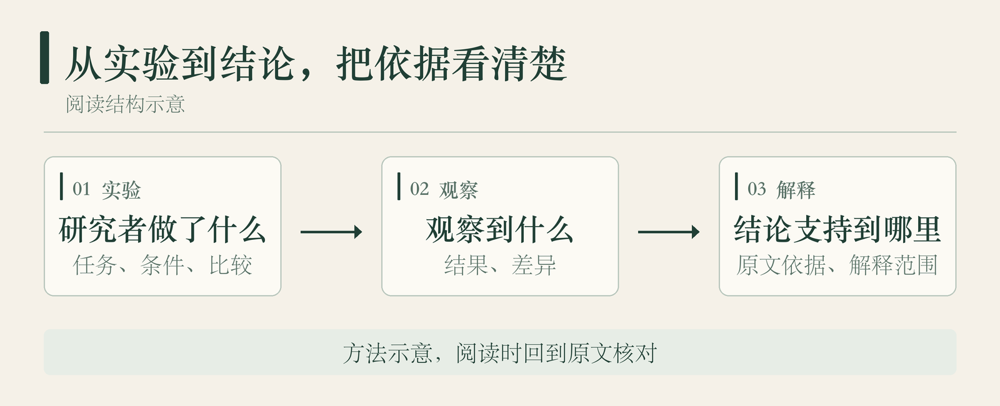
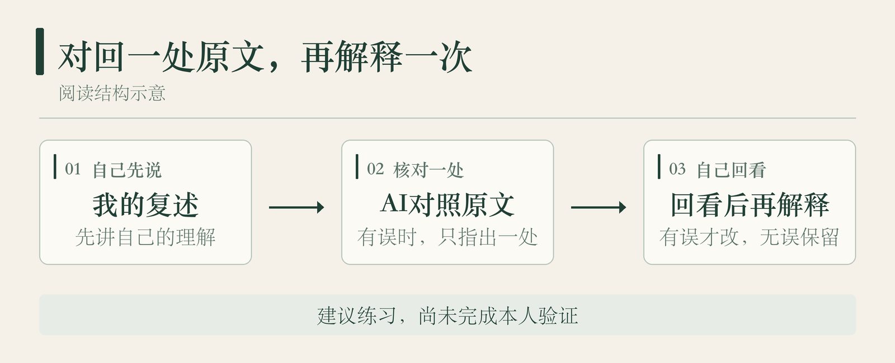

9月23日，我开始读《决策与判断》，请AI带着我读。读第一章“选择性知觉”时，我把自己的理解说给它听。

异常扑克牌给我留下了印象。牌的颜色和花色不按通常的搭配出现，人却可能把它看成熟悉的牌。我谈到预期会影响观看，也联想到以前摄影时怎样观察。随后，我复述了章末的几个问题：有没有受动机驱使，有没有加入自己的预期，有没有和不同意见的人交换看法。

这些内容，我已经能说出来。同时，我也提到自己的阅读方式：

> 这些实验我看得比较快，因为最后我就往结论上去了。

下一次读到这样的段落，我准备多停一下。挑一个实验，看看自己能不能把结论怎样得来讲具体，再请AI对照原文帮我看一处。

## 先把这个实验讲具体

第一章用异常扑克牌说明预期怎样影响知觉。知觉就是我们怎样辨认、理解眼前的东西。这里可以把研究者的做法、观察到的结果和解释分开看。

1949年，布鲁纳和波斯特曼向参加实验的大学生短时展示扑克牌。其中有正常牌，也有颜色与花色搭配异常的牌，比如黑色红心和红色黑桃。参加者要报告自己看到了什么。

异常牌通常更难被准确识别。面对红色黑桃，有人按花色认成普通黑桃，也有人按颜色认成红心。随着展示继续，也会有人认出异常。这些做法与结果可以在[原论文](https://psychclassics.yorku.ca/Bruner/Cards/)中核对。

《决策与判断》借这个例子讨论，过去的经验和预期怎样影响眼前的辨认。这里的“预期”很具体：我们已经熟悉黑色配黑桃、红色配红心，遇到不合这个搭配的牌时，识别可能出问题。

读到这儿，可以联想到生活里先入为主的判断。我当时也这样联想过。但在这篇文章里，我想把界线留清楚：这个实验直接观察的是特定展示条件下的扑克牌识别。把它写成“人人只看见自己想看的东西”，范围就大了。我想把实验里观察到的现象、书里的解释和自己的联想分开。

*图1｜文章整理示意，帮助区分做法、结果与结论，不是原实验图。*

“预期会影响观看”这个概括值得留下。再往前走一步，还可以问：这里究竟改了什么？记录的是什么反应？我从中想到的事情，哪些在实验里出现过，哪些是自己的延伸？

这样回看，注意力就有了具体去处。仍然停在这一小段，把牌怎样展示、参加者怎样回答说清楚，再看书中的解释。

## 请AI帮我找一处，再自己回去看

我准备尝试的办法很小：选一段已经读过、自己想核对的实验说明，先暂时移开原文，用自己的话讲一遍。不要求长，也不要求背出术语。先说研究者做了什么，接着说观察到了什么，再说作者据此解释什么。

想不起来，可以看回原文。原文没有交代的细节，就先留下“这里没说明”。不用为了把故事讲完整，补一个看起来合理的条件。

然后，把这段复述和对应原文一起交给AI。你也可以这样试：

> 请对照这段原文和我的复述，只找一处最需要回查的错误或遗漏，指出对应句子，说明为什么。没有明确问题就说“此次无需改”；没有出处或依据不足就说“无法判断”。不要替我重写答案，也不要补出原文没说的条件。

给出自己的复述，是为了让AI检查具体说法。给出原文，是为了让它的意见有地方可以核对。只找一处，方便自己回去读，不必把一次讨论做成整章批改。

*图2｜建议练习，尚未完成本人验证。无需修改时，保留原复述即可。*

拿到回复后，先看它指出的原文。那句话真的在那里吗？它是在纠正自己的复述，还是加了原文之外的解释？

例如，复述只说“异常牌更难认”，AI若指出漏了“短时展示”，就回去确认这个条件。确认确实需要补上，再自己重新解释。这个例子是练习示意，并非我已经做过的一次陪读对话。

需要修改时，把前后两次复述和对应原文放在一起。检查改动能否说明依据：加上了哪个条件，修正了哪个观察结果，或者把自己的联想从作者结论里分了出来。只有句子变顺了，还要继续看意思有没有变准。

如果原来的复述没有明确问题，就记“此次无需改”，不必凑第二版。AI的肯定也只是反馈，不能凭这一句认定自己已经全面理解。AI说无法判断，或者给不出出处，也先保留这个疑点。等找到材料再处理，不急着接受它的判断。

这套回查办法，我准备在下一次阅读时试一试。效果要留待实际阅读来观察。它适合想核对一段论证的时候。读书只是为了放松，也可以顺着读下去，不用每章都留下练习。

我想先从那次阅读里的扑克牌实验开始。把自己的理解说出来，再回到一处原文，看看结论是怎样得到的。一次读书，能在这里多停一下，就够了。
